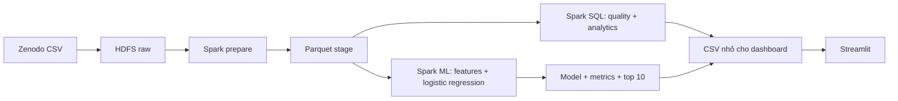

# Báo cáo bài tập lớn: Hệ thống Big Data phân tích và dự đoán sản phẩm

## 1. Tóm tắt

Hệ thống khai thác lịch sử đơn hàng Instacart để (1) mô tả nhu cầu mua sắm theo thời gian, sản phẩm và danh mục; (2) dự đoán sản phẩm đã mua nào sẽ xuất hiện trong đơn tiếp theo; (3) tạo danh sách gợi ý top 10 cho từng khách hàng. Dữ liệu gốc được lưu trong HDFS; Spark SQL thực hiện xử lý và tổng hợp; Spark ML huấn luyện mô hình; Streamlit trình bày kết quả.

Đây là bài toán **mua lại sản phẩm** (reorder prediction), không phải dự báo doanh thu hay khám phá sản phẩm hoàn toàn mới. Giới hạn này giúp mục tiêu dự đoán khớp với bộ dữ liệu và có thể đánh giá khách quan.

## 2. Nguồn dữ liệu và quy mô

Nguồn: [Zenodo record 2654444](https://zenodo.org/records/2654444), DOI `10.5281/zenodo.2654444`, truy cập ngày 01/11/2026. Bản ghi mô tả hơn 3 triệu đơn hàng của hơn 200 nghìn người dùng. Sáu file dùng trong dự án:

| Bảng | Khóa và ý nghĩa |
|---|---|
| `orders.csv` | `order_id`, `user_id`, tập `prior/train/test`, số thứ tự đơn, thứ, giờ, ngày kể từ đơn trước |
| `order_products__prior.csv` | Sản phẩm trong các đơn lịch sử, vị trí thêm vào giỏ, cờ mua lại |
| `order_products__train.csv` | Sản phẩm thật của đơn mục tiêu đã biết, dùng tạo nhãn |
| `products.csv` | Tên sản phẩm, mã aisle, mã department |
| `aisles.csv` | Tên aisle |
| `departments.csv` | Tên department |

Script tải dùng Zenodo API và so sánh MD5 từng file. Bảng `train` chỉ chứa sản phẩm có trong đơn mục tiêu; các cặp khách hàng–sản phẩm đã mua trong lịch sử nhưng không có trong `train` được gán nhãn 0.

## 3. Kiến trúc

Theo thiết kế cụm, Master chạy NameNode, ResourceManager và Spark driver; hai Slave chạy DataNode, NodeManager và dự kiến mỗi máy một Spark executor theo cấu hình 512 MB heap + 384 MB overhead. HDFS lưu dữ liệu gốc, Parquet đã chuẩn hóa, kết quả và mô hình. Chế độ `demo` lấy xấp xỉ 1% khách hàng để phù hợp 8 GB RAM tổng cho ba VM; chế độ `full` giữ toàn bộ. Vị trí executor cần xác nhận trên Spark UI sau khi triển khai.

## 4. Quy trình xử lý

1. **Nạp CSV:** schema được khai báo tường minh, tùy chọn escape cho dấu `"` theo file nguồn; lỗi định dạng làm job thất bại (`FAILFAST`).
2. **Lấy mẫu theo khách hàng:** giữ `user_id % sample_mod == 0`, nên toàn bộ các đơn của một người vẫn đi cùng nhau. `sample_mod=1` dùng toàn bộ.
3. **Lưu Parquet:** các bảng lịch sử, mục tiêu và danh mục ở định dạng cột để giảm chi phí đọc lặp.
4. **Kiểm tra chất lượng:** đếm bản ghi, khóa trùng, order/product mồ côi, thứ/giờ và cờ `reordered` ngoài miền.
5. **Phân tích:** top 20 sản phẩm, tỉ lệ mua lại theo sản phẩm/danh mục, đơn theo giờ/thứ và phân bố kích thước giỏ.
6. **Tạo đặc trưng:** gom lịch sử theo cặp khách hàng–sản phẩm, theo khách hàng và theo sản phẩm.
7. **Huấn luyện:** Spark ML logistic regression. Chia tập theo hash của `user_id`: 4/5 train, 1/5 validation.
8. **Đánh giá:** PR-AUC, ROC-AUC và các chỉ số top 10; so với baseline xếp hạng bằng số lần mua trước.
9. **Suy luận:** áp dụng mô hình cho khách hàng trong tập `test`, lấy 10 sản phẩm có điểm cao nhất/người.

## 5. Đặc trưng và chống rò rỉ dữ liệu

| Nhóm | Đặc trưng |
|---|---|
| Người–sản phẩm | số lần mua, số lần mua lại, vị trí giỏ trung bình, lần mua đầu/cuối, tần suất mua, số đơn kể từ lần mua cuối |
| Khách hàng | số đơn lịch sử, tổng sản phẩm, số sản phẩm khác nhau, tỉ lệ mua lại |
| Sản phẩm | tổng lần mua và tỉ lệ mua lại trong tập `prior` |
| Đơn mục tiêu | thứ, giờ, số ngày từ đơn trước |

Tất cả thống kê hành vi chỉ dùng các đơn `prior`. Các cột thứ/giờ/khoảng cách ngày của đơn mục tiêu là thông tin đã có khi cần gợi ý. Không dùng `order_products__train.csv` để xây dựng đặc trưng. `train` chỉ cung cấp nhãn; `test` không có nhãn. Chia theo khách hàng để tránh cùng một người có mặt ở cả hai phía đánh giá.

## 6. Định nghĩa chỉ số

- **PR-AUC:** diện tích dưới đường Precision–Recall; hữu ích khi nhãn 1 ít hơn nhãn 0.
- **ROC-AUC:** khả năng xếp mẫu dương cao hơn mẫu âm.
- **Precision@10:** trung bình theo người của `số sản phẩm mua lại đúng trong top 10 / min(10, số ứng viên)`.
- **Recall@10:** trung bình theo người có ít nhất một sản phẩm mua lại của `số mua lại đúng trong top 10 / số mua lại trong tập ứng viên`.
- **Hit rate@10:** tỉ lệ khách hàng có ít nhất một sản phẩm mua lại đúng trong top 10.
- **Repeat item coverage:** phần trăm dòng sản phẩm của đơn mục tiêu đã từng được khách mua; đây là trần bao phủ của tập ứng viên hiện tại.
- **Baseline:** xếp ứng viên theo số lần đã mua, hòa điểm theo `product_id` để tái lập kết quả.

Chỉ số top 10 đo **mua lại trong tập ứng viên**. Sản phẩm lần đầu xuất hiện ở đơn kế tiếp nằm ngoài phạm vi gợi ý. Không dùng accuracy đơn thuần vì mẫu âm nhiều và dự đoán toàn 0 có thể cho accuracy cao nhưng không giúp gợi ý.

## 7. Kết quả thực nghiệm

**Kiểm thử cục bộ bằng Spark `local[2]` trên WSL, chế độ demo:** 2.062 khách hàng, 34.275 đơn, 330.249 dòng sản phẩm lịch sử, 13.783 dòng nhãn `train` và 49.688 sản phẩm trong danh mục. Các kiểm tra khóa trùng, khóa ngoại và miền giá trị hiện có đều trả về 0 lỗi. Giờ có nhiều đơn lịch sử nhất là 11h (2.757 đơn), mã thứ nổi bật là `1` (5.746 đơn). Sản phẩm bán nhiều nhất trong mẫu là Banana (4.828 lần); danh mục `produce` có 95.274 dòng sản phẩm. Giỏ hàng lịch sử trung bình 10,25 sản phẩm.

Các con số trên là **mẫu demo 1%**, không phải thống kê toàn bộ tập Instacart. Chạy `bash scripts/run_cluster.sh demo` hoặc `full` trên ba VM để lấy minh chứng xử lý phân tán. Không dùng số của fixture làm kết quả thực nghiệm chính.

| Chế độ | PR-AUC | ROC-AUC | Precision@10 | Recall@10 | Hit rate@10 | Baseline Precision@10 |
|---|---:|---:|---:|---:|---:|---:|
| Demo 1%, Spark `local[2]` trên WSL | 0,410 | 0,824 | 0,308 | 0,567 | 0,891 | 0,294 |
| Cụm ba VM / full | chưa chạy | chưa chạy | chưa chạy | chưa chạy | chưa chạy | chưa chạy |

Tập validation gồm 257 khách hàng và 16.614 cặp ứng viên; tỉ lệ nhãn dương là 10,18%. Khoảng 60,18% dòng sản phẩm của đơn mục tiêu là sản phẩm đã từng mua, tức có thể được tập ứng viên hiện tại bao phủ. Precision@10 của mô hình cao hơn baseline khoảng 0,014 điểm tuyệt đối trong mẫu demo; đây là kết quả kiểm thử cục bộ, chưa phải kết quả trên cụm ba VM hay toàn bộ dữ liệu.

Bước suy luận đã tạo 7.126 dòng gợi ý cho 732 khách hàng trong tập `test` của mẫu. Một số khách có dưới 10 sản phẩm từng mua nên danh sách gợi ý ngắn hơn 10. Không có cặp khách hàng–sản phẩm trùng trong kết quả.

Chụp Spark UI và HDFS/YARN lúc chạy để chứng minh xử lý phân tán. Bản fixture chỉ kiểm tra tính đúng của các bước, không đại diện cho hiệu năng hay chất lượng mô hình trên dữ liệu thật.

## 8. Hạn chế và hướng phát triển

- Mô hình chỉ gợi ý các sản phẩm đã từng mua; có thể bổ sung candidate generation bằng ALS, association rules hoặc sản phẩm phổ biến theo danh mục để xử lý sản phẩm mới.
- Dữ liệu không có ngày tháng tuyệt đối, giá bán hay tồn kho; không thể dự báo doanh thu hoặc tối ưu hàng tồn một cách đáng tin cậy.
- Demo 1% giúp chạy trên ba VM nhỏ nhưng các thống kê sản phẩm toàn cục sẽ khác full. Cần ghi rõ chế độ khi so sánh kết quả.
- Cụm VM 2 GB/worker giới hạn độ lớn shuffle và mô hình; có thể tăng RAM, dùng Parquet phân vùng, cache chọn lọc và tinh chỉnh số partition khi mở rộng.

## 9. Nguồn tham khảo

1. [Instacart Market Basket Analysis, Zenodo](https://zenodo.org/records/2654444).
2. [Apache Spark 3.5.9 PySpark installation](https://spark.apache.org/docs/3.5.9/api/python/getting_started/install.html).
3. [Apache Spark ML classification and regression](https://spark.apache.org/docs/3.5.9/ml-classification-regression.html).
